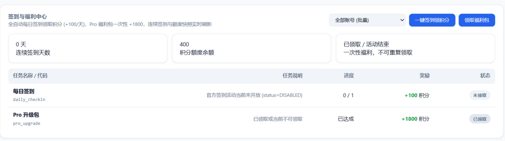

# 账号与签到

- [添加账号](#添加账号)
- [凭证与保活](#凭证与保活)
- [每日签到与活动](#每日签到与活动)
- [官方活动规则](#官方活动规则)
- [额度与余额](#额度与余额)
- [团队与企业账号](#团队与企业账号)
- [定时调度](#定时调度)

## 添加账号

在看板「账号」页操作。国内版和国际版的账号可以放在同一个池里。

| 方式 | 操作 |
|---|---|
| **导入本机凭证** | 点「扫描本地凭证」，弹窗会按区域列出检测到的凭证，选中后点「导入」 |
| **OAuth 设备授权** | 点「+ 添加账号 (OAuth)」，选择区域，在浏览器里打开官方授权链接完成登录。网关自动轮询结果并把账号加入池 |
| **PAT** | 在 Qoder 网页版「设置 → Personal Access Token」创建一个 `pt-` 令牌，然后在看板点「导入 PAT」并粘贴 |
| **JSON 导入 / 导出** | 可以导出全部或单个账号（凭证可选是否一并导出）；导入时支持预检（Dry-Run）和按 UID 覆盖 |

**扫描本地凭证**会读取以下位置，整个过程只读，导入前需要你逐条确认：

| 来源 | 国内版 | 国际版 |
|---|---|---|
| 桌面 App（仅 Windows） | `%APPDATA%\com.qodercn.app.stable\auth.v1.dat` | `%APPDATA%\com.qoder.app.stable\auth.v1.dat` |
| Qoder CLI | `~/.qoder-cn/.auth/user*` | `~/.qoder/.auth/user*` |

网关启动时如果发现本机凭证，只会在日志里提示数量，不会自动导入。

## 凭证与保活

| 类型 | 前缀 | 有效期 | 来源 |
|---|---|---|---|
| Access Token | `dt-` | 约 30 天 | OAuth 设备授权 |
| Access Token | `jt-` | 24 小时 | PAT 交换 |
| Refresh Token | `drt-` | 约 1 年，每次刷新都会更换 | OAuth 设备授权 |
| Refresh Token | `jrt-` | 48 小时 | PAT 交换 |
| Personal Token | `pt-` | 长期 | 看板导入 |

- 刷新时按 Refresh Token 的前缀选择接口：`drt-` 走 `deviceToken/refresh`，`jrt-` 走 `jobToken/refresh`。都失败时用 PAT 重新换取
- PAT 只作为最后的兜底，不会覆盖仍然有效的 OAuth 会话
- 如果上游返回 `TOKEN_EXPIRE`、`12153` 或 `Offline user session not found`，网关会停用该账号，并标记为「需重新登录」
- 账号文件里的 Token 以明文保存，请保护好 `accounts/` 目录

## 每日签到与活动

官方现在的每日签到是一个「活动」：每天可以领 100 Credits。网关会列出账号的活动，然后对状态为 `CLAIMABLE` 的项直接领取。领取接口是幂等的，重复领取不会重复发放。

看板上和签到相关的按钮：

| 按钮 | 做什么 |
|---|---|
| 账号页「每日签到」 | 只领每日 Credits |
| 签到与福利中心「领取全部福利」 | 每日 Credits + 兑换码类活动 + Pro 福利包 |
| 签到与福利中心「仅领 Pro 福利包」 | 只领 Pro 福利包（一次性 +1800 积分） |

签到结果会如实显示：已到账、今天已领过、暂时没有可领的活动、名额已发完，或者失败及原因。同时会给出下次可以领取的时间（每天 10:00，UTC+8）。

**兑换码类活动**（例如「奶茶免单卡」）：

- 活动要求的任务需要在官方客户端里完成（例如用桌面端发布一个站点），网关不会代做任务
- 任务完成之后，整点巡检或点击「一键签到」时会自动领取；当天名额发完的话，第二天 10:00 之后会自动重试
- 领到的兑换码按账号保存在账号文件的 `campaignCodes` 里，重启后不会丢失，看板会按账号显示
- 上游判定为「同一人已领取」（`SAME_PERSON_ALREADY_CLAIMED`）的账号，6 小时内不再重复尝试

## 官方活动规则

下表综合了官方文档和实际测试的结果，可以用来理解「为什么有的账号有活动、有的没有」：

| 项目 | 国际版 | 国内版 |
|---|---|---|
| 每日 100 Credits | 每天 10:00（UTC+8）刷新，错过不补，领到后 30 天内有效，仅桌面端可领。实测**按「人」去重**：同一台机器上的多个账号每轮共享一次 | 规则相同 |
| 新人权益 | 14 天 Pro 试用 + 300 Credits，在首次登录最新版桌面客户端时发放。虚拟机环境不参与；每人限一次，额外注册的试用账号会被冻结 | 新用户活动（例如「奶茶免单卡」），需要先在桌面端完成新人任务，每日限量 |
| 每月基础额度 | Free 档为 0 Credits | 按套餐发放 |
| 风控 | 官方组件会上报机器身份并检测虚拟机，活动按真实的机器身份定向下发 | 相同 |

**注册了好几个号，却没有新人 300 或签到活动**，常见原因有：

1. 运行在虚拟机或云桌面里
2. 同一个人批量注册：第一个账号拿到试用后，其余账号会被冻结
3. 只注册了网页账号，从没登录过最新版桌面客户端
4. 错过了当天的领取窗口

> 虚拟机检测有误报。开启了 VBS / 内核隔离的 Windows 11 实体机，以及部分 Linux 实体机，也会被判定为 `isVm=true`。可以在看板「签到与福利中心」的「本机虚拟化检测」卡片里查看，或者运行 `python _diag_campaign.py`。

国际版签到依赖真实机器身份，详见[故障排查 · 国际版签到需要真实机器身份](troubleshooting.md#国际版签到需要真实机器身份)。

## 额度与余额

- 余额来自官方的 `quota/usage` 接口，包括套餐额度和赠送 / 签到获得的额度；套餐名称来自 `user/plan` 接口
- 团队账号的共享额度（`orgResourcePackage`）会算进「有效余额」。余额护栏和自动解封判断的都是有效余额
- 余额在后台刷新：只有真正用过的账号才会刷新，默认每 5 分钟一次（`QD_CREDITS_USAGE_INTERVAL`），空闲时不轮询。签到成功后会立即刷新
- 账号行会显示余额的更新时间。查询失败时继续显示上一次的数值，并标注出来，不会把旧数值当成最新的
- 给其他系统轮询用的余额接口是 `GET /credits/summary`：它只返回网关本地记录的数值，不会请求上游，见[接口参考](api.md)

## 官方积分消耗（口径差异）

面板「用量洞察 → 官方积分消耗」读的是**官方接口**（`credits-summary` / `credits-heatmap`，0.4.3 客户端引入），与另外两处口径不同，别混用：

| 数据 | 来源 | 含义 |
|---|---|---|
| 官方积分消耗 | `/sash/api/v1/ai-conversations/credits-summary` + `credits-heatmap` | 上游记账的真实消耗（credits）与单日峰值 |
| 剩余用量估算 | 本机 `usage.jsonl` + 账号余额 | 按近 24 小时本地记录线性外推的「还能用几天」 |
| 等价花费 | 本地 token × OpenRouter 参考价 | 仅估算，不用于结算 |

该接口是全量聚合：网关按账号缓存 5 分钟，面板另外做 60 秒节流——它不该跟着 5 秒轮询打。

顺带：同一批接口里还有 `/sash/api/v1/me/achievements`（已获成就 key），用于解释「活动需要先完成某成就」。网关已把它封成 `Account.fetch_achievements()`，面板暂未展示。

## 团队与企业账号

团队 / 企业账号在网关里和个人账号的用法相同，额度走组织共享池（看板显示为「共享额度」）。但风控和审计的对象是**账号**，不是网关，所以网关为团队账号提供了一层自用保护，先避开那些能由客户端行为避免的风险：

### 怎么把企业账号接进来

和个人账号**完全一样**：面板「添加账号（OAuth）」走同一条设备授权流程，或者在「导入 PAT」里粘贴组织下发的个人访问令牌。不需要额外配置，也不用换端口。

登录成功后，`/api/v1/userinfo` 返回的 `organization_id` / `organization_name` 会一起存进账号文件，面板上该账号会带一个紫色的 **企业 · 组织名** 徽标。

判定是否为团队 / 企业的口径（`Account.is_team()`，#90 起三层优先）：

1. 账号带 `organization_id` / `organization_name`（OAuth 登录即有）—— **最可靠**；
2. `userType` 含 `team` / `enterprise`（PAT 导入等路径）；
3. 额度快照里有组织共享池（`orgResourcePackage` 等）。

> #90 之前只认第 2、3 条，而 userinfo **根本不返回 `user_type`**，所以企业号会被误判成个人号：团队闸门不生效、共享额度不计入有效余额。现在组织字段是第一判据。

### 「企业号抓不到」的常见原因

| 现象 | 原因 | 处理 |
|---|---|---|
| OAuth 登录后账号列表没有新账号 | 组织强制 SSO，设备授权流程被拦 | 用「导入 PAT」：在组织后台签发个人访问令牌，粘贴进网关 |
| 有账号，但没有「企业」徽标 | userinfo 的 `organization_id` 为空 —— 这是个人身份在组织下的号，不是组织席位 | 确认组织邀请已接受、席位已分配 |
| 有徽标，但看不到共享额度 | 组织没开共享额度池，或该席位额度是「不限量」哨兵（`cap=-1`） | 看板会显示「共享额度」行；`cap=-1` 显示为无限 |
| 额度一直是 0，请求 402 | 席位额度已用尽 / 组织停用 | 找组织管理员；网关会把上游原因写进账号行 |

网关对共享额度的处理（#39 / #67）：`remain_effective = 套餐剩余 + 可用的共享池剩余`；余额护栏、自动解封、耗尽判定都用这个值。`cap=-1` 视为「不限量」，不会被算成 `-1` 或占位的 `remaining`。
| 风险 | 网关的做法 | 开关（默认值） |
|---|---|---|
| 单个席位被并发打满，触发 10605 排队 | 每个账号设并发上限，超出的请求排队等待，不并发打上游 | `QD_TEAM_MAX_CONCURRENCY=1` |
| 机器式的固定请求节奏 | 同一账号两次请求之间保持最小间隔，并加少量抖动 | `QD_TEAM_MIN_GAP_MS=400` |
| 账号被多人共用，组织审计可见 | 统计一小时内同一账号来自几个客户端 IP，超过阈值打印 WARN | `QD_TEAM_MAX_CLIENTS=3` |
| 排队被当成失败 | 排队时按 `retryAfterSeconds` 等待后重试 | 内置 |

- 默认只对识别为团队 / 企业的账号生效：`userType` 含 `team` / `enterprise`，或者额度快照里有共享额度。`QD_TEAM_GUARD=on` 对所有账号生效，`off` 关闭
- 个人账号同样担心并发过高时，可以设 `QD_TRAFFIC_GUARD=on`，让所有账号都走这套限制；`QD_TRAFFIC_GUARD=off` 则全部关闭
- 拿不到并发名额时最多等待 `QD_TEAM_WAIT_SECS`（默认 30 秒），超时后放行并打印 WARN，不会卡死

**网关无法替你避免的**（属于使用方式和合约层面，需要自己判断）：

- 组织后台的用量与成员审计：你的调用会记在你名下
- 席位被回收、Token 被重置：网关会立即失效
- 把公司席位共享给组织外的人：额度、审计、服务条款都会出问题
- 从数据中心出口访问国际版容易被风控，见[容器启动自检](deployment.md#容器启动自检)

更完整的风控分析见[风控与排队](risk-control-and-queueing.md)和[风控处置手册](risk-control-playbook.md)。

## 账号表排序（#111）

账号管理表格的**版本 / 账号 / 状态 / 积分 / 请求 / 总 token / 缓存**七列可点表头排序：

- 第一次点击升序、第二次降序、第三次恢复后端原序；当前列显示 ▲ / ▼；
- 排序状态存在 `localStorage.qd-acct-sort`，刷新后保持；
- **账号列用自然序**（`Z Z2` 排在 `Z Z10` 前，忽略大小写与首尾空白，昵称缺失时退回 UID）；
- **积分列两种口径**：点击=剩余额度，`Shift+点击`=已用额度；
- **取不到值的一律沉底**且不随方向翻转——额度查询失败（`envelopes HTTP 403 code 112` 这类）的账号不会被当成 0 混进「额度用尽」中间；
- 状态列按「可用 → 异常 → 冷却 → 停用 → 过期」排序；护栏与操作列不参与排序。

## 上下文窗口（#106）

官方清单里多数模型的 `max_input_tokens` 默认落在 200K 档，而模型本身支持 1M/400K。网关现在允许两处设置：

| 方式 | 生效范围 | 用法 |
|---|---|---|
| 面板「模型库 → 上下文设置」下拉 | 该模型的全局默认 | 写入 `accounts/settings.json` 的 `model_context`，立即生效（新请求起） |
| 请求头 `X-QD-Context: 1M`（或 token 数） | 单次请求，优先级高于面板 | chat / responses / anthropic 三个端点都支持；无法抬到官方档位之外（如 `2M` 会被忽略并 WARN） |

- 档位名对照官方 `context_config`（`1M` / `400K` / `200K`，大小写不敏感），也可以直接填 token 数；
- 生效位置是出站请求体的 `model_config.max_input_tokens`，与官方桌面端选择档位是同一通道；
- 客户端**不能**通过 body 里的 `_qd_context` 字段伪造（入口会先清除，只有 HTTP 头有效）；
- 面板清除选择 = 回到官方默认档。

## Kimi 等新模型被上游回退成 auto（#105）

2026-10 实测：CN 区把 `kmodel_latest`（Kimi-K3 / K3.1-Pro）发给上游，上游**不报错**，但按 `auto` 路由与计费（官方清单同时给这些模型标了 `minimal_version.vsc = 999.999.999`，即该形态未放量）。这不是网关能修的——客户端版本身份是 COSY 签名的一部分，伪造更高版本只会把账号推进风控画像。

网关能做的是**让这件事可见**：

- usage 行新增 `billed_model`：仅当上游 usage 里的 model 与请求模型不一致时写入（一致时行格式零变化）；
- 日志出现 `upstream billed a different model: requested=Kimi-K3 billed=auto`（WARN）；
- 面板「最近请求」在模型列显示 `计费→auto` 红标——一眼看出「你以为在用 Kimi，其实在用 auto」。

排查方法：想看某模型是否真被上游接受，直接看面板最近请求列有没有 `计费→` 徽标，或 grep 日志 `billed a different model`。

## 禁用与签到（#102）

「禁用」只表示**不接推理流量**，不该顺带停掉每日签到——账号级奖励照领、会话也保持活性（效果近似 keepalive）。

- 停用的账号行会多一个 **仍签到** 勾选（`checkinWhenDisabled`，默认关 = 维持历史行为）；
- 勾上后：面板「每日签到」、任务中心批量签到、调度器整点签到都会带上它；
- **凭证失效（无 token）与过期账号始终排除**——签了必然失败，还会用退化响应覆盖余额快照；
- 推理选号口径不变：`inference_eligible()` 仍然只看 `enabled + token`。

对应接口：`POST /accounts/checkin-when-disabled {uid, value}`。

## 定时调度

调度器随网关一起启动，时间以网关所在机器的本地时区为准（Docker 镜像默认 `TZ=Asia/Shanghai`）：

| 时间 | 任务 |
|---|---|
| 每天 09:00、21:00 | 为所有账号签到，并刷新额度快照 |
| 每天 22:00 | 集中刷新所有账号的 Token |
| 每次巡检 | 提前刷新剩余有效期不足 4 小时的 Token |

- 调度状态保存在 `accounts/scheduler/state.json`，网关重启后不会重复签到
- 看板可以开关调度器，也可以立即执行一次巡检（`POST /scheduler/trigger`）
