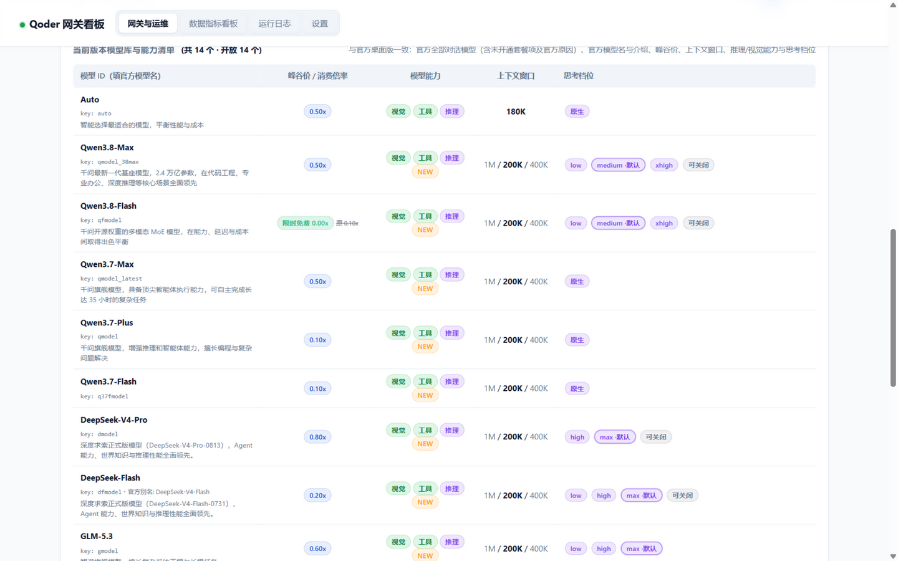

# 模型

- [模型来源](#模型来源)
- [模型命名](#模型命名)
- [双区路由](#双区路由)
- [峰谷价](#峰谷价)
- [思考档位](#思考档位)

## 模型来源

`/v1/models` 和看板「模型库」的数据按以下优先级获取，目的是和官方桌面客户端此刻显示的清单保持一致：

1. **官方动态接口** `/algo/api/v2/model/list`：需要账号，返回官方当前的清单。每次获取成功都会写入磁盘缓存
2. **磁盘缓存** `accounts/models-cache-<区域>.json`：上次从动态接口获取成功的结果，7 天内有效。容器重启或上游暂时不可用时先用它，不必退回到可能已经过时的内置快照
3. **本机官方客户端的模型目录缓存** `~/.qoder*/.models/<uid>/catalog-v6`：离线也能用
4. **仓库内置的快照** `qoder_catalog_cn.json` / `qoder_catalog_intl.json`：可以用 `python _refresh_catalog.py` 从本机客户端更新

清单在内存中缓存 5 分钟。想立即重新获取，调用 `GET /models/refresh`（需要 API Key）。

- 清单以动态接口返回的为准，国内版和国际版各不相同
- 官方标记为不可用（`enable=false`）的模型也会列出来，并附上官方给出的原因（`disabled_reason`）
- 官方没有提供的字段（例如最大输出长度）不会填写，网关不编造数据
- 当前使用的是哪个快照，可以通过 `/v1/models` 的 `catalog_source` 字段查看

每个模型的主要字段：

| 字段 | 含义 |
|---|---|
| `id` | 官方模型名，客户端里填这个 |
| `upstream_key` / `aliases` | 内部 key 及其他可用写法 |
| `name_local` / `description` | 本地化名称和官方介绍 |
| `context_windows` / `context_window_default` | 可选的上下文窗口（如 200K / 400K / 1M）及默认值 |
| `reasoning_efforts` / `reasoning_default_effort` | 合法的思考档位及默认档位 |
| `price_factor` / `price_factor_peak` / `price_factor_valley` / `off_peak` / `off_peak_active_now` | 计费倍率和峰谷时段 |
| `enabled` / `disabled_reason` | 是否可用；不可用时附官方原因 |
| `realm` / `realm_exclusive` | 所属区域；是否只在这个区域提供 |

## 模型命名

以下写法都能识别为同一个模型：

| 写法 | 示例 |
|---|---|
| 官方模型名（推荐） | `Qwen3.8-Max` |
| 内部 key | `qmodel_38max` |
| 展示 id | `qmodel_38max (Qwen3.8-Max)` |
| 小写别名 | `qwen3.8-max` |

注意：同一个 key 在两个区域可能对应不同的模型。例如 `mmodel` 在国内版是 MiniMax-M2.7，在国际版是 MiniMax-M3。

## 双区路由

一次请求走哪个区域，按以下优先级决定：

1. 请求里显式指定：`?realm=` 查询参数、Key 绑定的出口、`X-Realm` 请求头
2. 自动选区（`QD_AUTO_REALM=1`，默认开启）：
   - 模型只在某一个区域提供时，走那个区域。只在国内版提供的有 `q37fmodel`、`gm51model`；只在国际版提供的有 `ultimate`、`performance`、`efficient`、`smodel`、`cmodel`
   - 当前区域没有可用账号时，改走另一个区域
3. 看板顶部的全局出口

- 自动选区只在能明确判断时才切换区域：两个区域都有的同名模型，始终留在当前区域
- 实际走的区域会写进响应头 `X-Qoder-Realm`，切换原因写进 `X-Qoder-Realm-Reason`（取值为 `model_missing` 或 `no_account`）
- 看板「最近请求」里每条请求都会显示实际出口
- 想同时查看两个区域的模型：`GET /v1/models?merge_realms=1`

## 峰谷价

部分模型在低谷时段（22:00–08:00，UTC+8）有折扣，例如：

| 模型 | 峰价 | 折扣 |
|---|---|---|
| Qwen3.8-Max | 0.50x | 错峰 4 折 |
| Qwen3.7-Max | 0.50x | 错峰 2 折 |
| Qwen3.7-Plus | 0.10x | 错峰 4 折 |

具体价格以 `/v1/models` 为准。`off_peak_active_now` 表示当前是否处于低谷时段。看板在低谷时段会把价格高亮显示。

## 思考档位

官方上游的思考参数是 `parameters.reasoning_effort`，但每个模型支持的档位不同。**上游收到不支持的档位时不会报错，而是悄悄改用默认档位。** 所以网关会先按官方目录把档位归一化：

- 档位合法：原样透传
- 档位不合法：改为最接近的合法档位；距离相同时偏向模型的默认档位。日志里会记录这次调整
- 模型只支持开关思考、没有档位表时：不下发档位，只保留 `none`（关闭思考）
- 模型完全没有思考配置（例如 `auto`）：原样透传

示例（以官方目录为准）：

| 模型 | 支持的档位 | 默认 | 归一化示例 |
|---|---|---|---|
| Qwen3.8-Max / Qwen3.8-Flash | `low` / `medium` / `xhigh` | `medium` | `high` → `medium`，`max` → `xhigh` |
| DeepSeek-Flash | `low` / `high` / `max` | `max` | `medium` → `high`，`xhigh` → `max` |
| Qwen3.7-Plus | 只能开或关 | — | 只有 `none` 生效 |

请求里的写法支持 `reasoning_effort`、`reasoning.effort`、`thinking.effort` 或 `thinking.level`。

Anthropic 入口的额外规则：

- 档位按 `thinking.effort` → `output_config.effort` → `thinking.budget_tokens` 的顺序取第一个有效值。Claude Code 对第三方模型名发送的是 `thinking={"type":"adaptive"}` 加 `output_config.effort`，因此按后者处理
- `thinking.budget_tokens` 按区间映射：≤1024 为 `minimal`，≤4096 为 `low`，≤16384 为 `medium`，≤32768 为 `high`，更大为 `max`
- `thinking.type` 为 `disabled` 时不下发档位，由上游按模型默认处理
